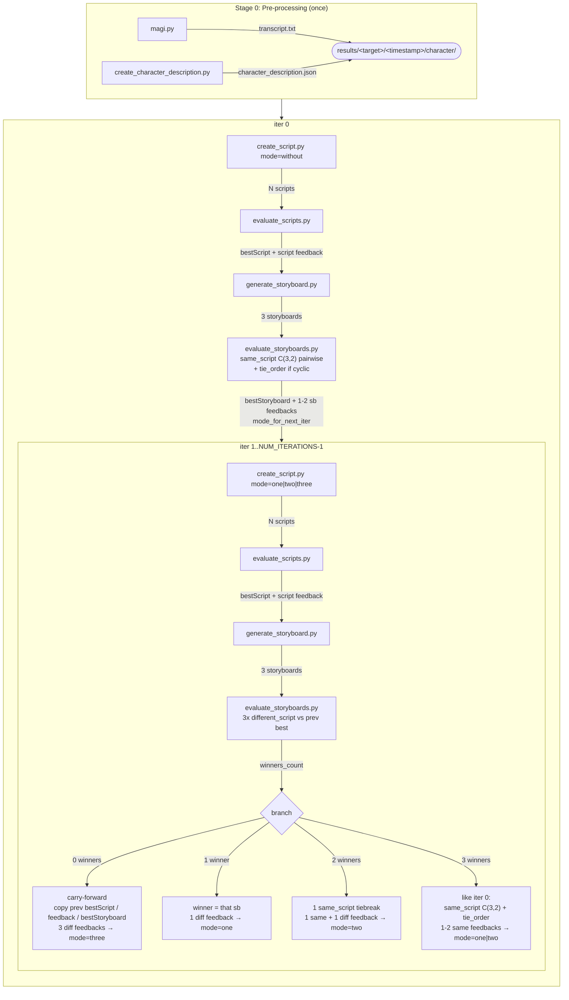

## Setup

### 1. Conda environment

```bash
conda create -n project python=3.12 -y
conda activate project
pip install -r requirements.txt
```

### 2. Google Cloud auth (Vertex AI)

The pipeline uses Vertex AI (`vertexai=True`). Authenticate once:

```bash
gcloud auth application-default login
```

### 3. `.env`

Copy the example file and fill in your values:

```bash
cp .env.example .env
```

```env
# Team default: Vertex AI — needs a GCP project with billing enabled and a
# service account with the "Vertex AI User" role (or
# `gcloud auth application-default login`, see step 2 above). Every Gemini call
# in the script/storyboard pipeline uses this whenever it's set.
GOOGLE_CLOUD_PROJECT=<your-gcp-project-id>
GOOGLE_CLOUD_LOCATION=global

# Fallback (only used when GOOGLE_CLOUD_PROJECT above is empty): a plain API key
# from https://aistudio.google.com/apikey — no GCP IAM/service-account/billing
# setup needed, useful if you don't have GCP project access.
GEMINI_API_KEY=<your-gemini-api-key>

# Models
TEXT_MODEL=gemini-3.1-pro-preview
IMAGE_MODEL=gemini-3-pro-image-preview
VIDEO_REVIEW_MODEL=gemini-3.1-pro-preview

# Pipeline defaults
NUM_SCRIPTS=3
NUM_CLIPS=6
NUM_STORYBOARDS=3
NUM_ITERATIONS=2
EXP1=0
EXP2=3

# Video generation — only the models you actually run need their key.
# -m minimax-local and -m anisora are self-hosted and need none.
ARK_API_KEY=<your-ark-key>          # -m seedance    https://console.volcengine.com/ark
DASHSCOPE_API_KEY=<your-key>        # -m wan         https://dashscope.console.aliyun.com/
MINIMAX_API_KEY=<your-key>          # -m minimax-api https://platform.minimax.io/
IMGBB_API_KEY=<your-imgbb-key>      # image hosting for the three above; https://api.imgbb.com/

# The exact version each -m submits
SEEDANCE_MODEL=dreamina-seedance-2-0-260128
WAN_MODEL=wan2.7-i2v
MINIMAX_MODEL=MiniMax-H3
MINIMAX_LOCAL_MODEL=MiniMaxAI/MiniMax-H3

# Model used when -m is omitted
VIDEO_GENERATION_MODEL=dreamina-seedance-2-0-260128

# Storyboard backend (default: gemini; see "FLUX.2 storyboard backend" below)
STORYBOARD_BACKEND=gemini
```

See [Hyperparameters](#hyperparameters-env) for what each variable means.

### 3b. (Optional) FLUX.2 storyboard backend

The default backend (`STORYBOARD_BACKEND=gemini`) uses Gemini's native image
generation for the whole 3×2 grid in one call. The `flux2` backend instead
generates each panel individually with FLUX.2-dev (3 seeded candidates per panel
by default), picks the best one per panel with a Gemini reviewer call (one
candidate scored per call, then compared in Python — not one call comparing all
candidates at once), then composes the grid locally. Needs a separate conda env
(FLUX.2-dev's `diffusers` dependency stack is incompatible with this repo's own
`transformers==4.38.0` pin used by MAGI):

```bash
bash setup_flux2_env.sh
```

Then run the pipeline with:

```bash
python src/run_all.py -t <target> --storyboard-backend flux2
```

See `.env.example` for the `FLUX2_*` tuning knobs (model id, resolution, steps,
guidance scale, number of variants per panel, HF token resolution). Note: unlike
the gemini backend, the flux2 backend never uses the few-shot examples in
`few-shot_example/` for either script generation or storyboard generation.

**Requirements before your first flux2 run:**

- **A CUDA GPU.** Unlike MAGI's panel detection (which falls back to CPU),
  `src/flux2_worker.py` has no CPU path — it needs an actual GPU.
- **~95GB of free disk** in the HF cache directory (`HF_HOME`, or
  `FLUX2_HF_HOME` to point the worker subprocess at a separate cache) — FLUX.2-dev
  is ~95GB in bf16. Budget a multi-hour download on first run
  (`FLUX2_WORKER_TIMEOUT` defaults generously for this).
- **A HuggingFace token from an account that accepted the gated license.**
  FLUX.2-dev is a gated repo: visit
  [huggingface.co/black-forest-labs/FLUX.2-dev](https://huggingface.co/black-forest-labs/FLUX.2-dev)
  while logged in and click "Agree", then either run `huggingface-cli login`,
  set `HF_TOKEN` directly, or point `FLUX2_HF_TOKEN_FILE` at a token file
  (defaults to `~/.cache/huggingface/token`).
- **GPU memory strategy** — `FLUX2_CPU_OFFLOAD` (default `true`) streams weights
  CPU↔GPU on demand: works on smaller GPUs, ~1-2 min/image. Setting it to
  `false` loads the whole model onto the GPU at once (faster per image, no
  transfer overhead), but the weights alone need ~95GB — confirmed to OOM even
  on a ~97GB card, so only try `false` if your GPU has real headroom above
  that.

**Known limitation — composition/pose fidelity on extreme panels.** Every panel
is generated at a fixed 768×640 landscape canvas (`FLUX2_PANEL_WIDTH`/
`FLUX2_PANEL_HEIGHT`) regardless of the source manga panel's own aspect ratio,
and `Flux2Pipeline` has no `strength`/denoising-strength parameter — the input
panel image is a loose conditioning signal, not a partial-denoise starting
point. On very tall/narrow or extreme-camera-angle source panels, FLUX.2 can
drift toward flatter, more centered compositions than the original. After a
run, check `<run>/iter<N>/storyboard/candidates/panel_review_*.json` for low
"Manga/Script Follow" scores — that's the reviewer independently flagging
panels worth a manual look or a rerun with more variants.

**Known limitation — on-screen text/speech-bubble/SFX suppression is not a hard
guarantee.** `Flux2Pipeline` has no `negative_prompt` — every instruction is
positive conditioning, so "don't draw text" is a request, not a constraint. The
flux2-only script prompts (`create_script_without_feedback_no_fewshot.txt` /
`create_script_with_one_feedback_flux2.txt`) keep spoken dialogue out of
`description`/`environment` entirely (it lives in its own structured
`dialogue` field instead, ignored by `flux2_bridge.py`'s image prompt), and
explicitly ban describing on-screen SFX lettering/onomatopoeia as a visual
element — including paraphrases of it, not just the literal words. A second,
independent layer (`flux2_bridge.py::_strip_dialogue()`'s regexes) scrubs
anything that leaks through anyway. Both layers were tightened multiple times
against real failures found on live runs (quoted dialogue with internal
apostrophes, possessive `'s`, multi-line "Character[id]: '...'" speaker
chains, "graphical letter-like strokes" as an SFX paraphrase) and a full
DualJustice1/goblin run currently comes back clean — but neither layer is a
mathematical guarantee against a new phrasing Gemini hasn't tried yet. If a
run comes back with unwanted text, check the clip's `environment`/`description`
in `<run>/iter<N>/bestScript.json` first — a new paraphrase there is the most
likely cause, fixable by extending the same two rules that already ban this.

### 4. Prepare a target

For each target, create a directory under `target/<name>/` containing:

```
target/<name>/
    manga_page.{png|jpg}              # full manga page  (or manga_page1.*, manga_page2.*, ...)
    ref.{png|jpg}                     # character reference sheet (legacy, single composite image)
    characters/                       # NEW, optional alternative to ref.* above
        char1.png                     # one clean reference image per character
        char2.png                     # (id matches Character[id] used everywhere else)
        ...
    manga_panels/                     # auto-generated by croppanels.py (see below)
        panel1.png
        ...
```

`characters/char{id}.*` takes priority over `ref.*` when both are present; when
`characters/` is absent (as for all existing targets), the pipeline falls back to
`ref.*` unchanged. This applies to both storyboard backends.

---

## Full Pipeline Usage

```bash
conda activate project

# 1. Auto-crop manga panels from the full manga page
python src/croppanels.py -t <target>

# 2. Run the storyboard pipeline (script → evaluation → storyboard, N iterations)
python src/run_all.py -t <target>

# override iteration count:
# This runs iter0, iter1, ..., iter<N-1>
python src/run_all.py -t <target> -n 3

# auto-resume from the first incomplete iteration/stage:
python src/run_all.py -t <target> --auto-resume

# auto-resume and continue until a specific final iteration:
# This runs/resumes up to iter5, including iter5
python src/run_all.py -t <target> --auto-resume --to-iter 5

# manually resume from a specific iteration:
# This starts from iter3 and continues to the default final iteration
python src/run_all.py -t <target> --from-iter 3

# manually resume from iter3 and stop after iter5:
python src/run_all.py -t <target> --from-iter 3 --to-iter 5

# select a different GCP project (default: GOOGLE_CLOUD_PROJECT):
python src/run_all.py -t <target> -p 2

# use the flux2 storyboard backend instead of gemini (needs `bash setup_flux2_env.sh` first):
python src/run_all.py -t <target> --storyboard-backend flux2

# write into / resume a specific run folder (default: newest when resuming, new one otherwise):
python src/run_all.py -t <target> --auto-resume --time 20260821_143000

# 3. Generate video from the best storyboard of the latest run
#    (the model decides the route — see "Video generation" below)
python src/create_video.py -t <target> -m seedance
```

When `--auto-resume` is enabled, `run_all.py` checks the existing output files in the run folder and skips completed stages automatically. For example, if `iter0` and `iter1` are complete but `iter2` is incomplete, the pipeline resumes from the missing part of `iter2` instead of starting over.

All input files come from `target/<target>/` and all results land in `results/<target>/`.

### Run folders (`--time`)

Every pipeline run writes into its own timestamped folder, `results/<target>/<YYYYMMDD_HHMMSS>/`, so a new run never overwrites an earlier one.

| Invocation | Run folder used |
|---|---|
| `run_all.py -t <target>` | a new timestamp |
| `run_all.py -t <target> --auto-resume` | the newest existing one |
| `run_all.py -t <target> --from-iter 3` | the newest existing one |
| `run_all.py -t <target> --time 20260821_143000` | exactly that one (created if missing) |

The tools that consume a finished run take the same `--time` flag and default to the newest run when it is omitted:

```bash
python src/crop_storyboard_panels.py -t <target> --time 20260821_143000
python src/create_video.py -t <target> -m seedance --time 20260821_143000
```

Video output is **not** per-run — it goes to `results/<target>/video/<model>/run_<timestamp>/`, where `--auto-resume` resumes the newest `run_*` folder.

Results produced before this layout sit directly under `results/<target>/` (`character/`, `iter*/`). They are not resumed in place; move them into a run folder first:

```bash
mkdir -p results/<target>/20260821_143000
mv results/<target>/character results/<target>/iter* results/<target>/log.txt results/<target>/20260821_143000/
```

### Panel cropping (`croppanels.py`)

Detects manga panels via the MAGI model and saves them in reading order (top-to-bottom rows, right-to-left within each row).

Supports single or multi-page input:

| Input file | Treated as |
|---|---|
| `manga_page.png` | page 1 |
| `manga_page1.png`, `manga_page2.png`, … | pages in numeric order |

Panels from all pages are numbered sequentially (`panel1.png`, `panel2.png`, …) in `target/<target>/manga_panels/`.

### Storyboard panel cropping (`crop_storyboard_panels.py`)

Same MAGI detection applied to a generated `bestStoryboard.*`, with left-to-right / top-to-bottom ordering and border trimming. Output goes next to the storyboard it cropped, i.e. `results/<target>/<timestamp>/iter<N>/storyboard_panels/`. `--iter` picks the iteration (default: the latest one that has a storyboard), `--time` picks the run.

`create_video.py` cuts them itself when the i2v route needs them and the run has none, by calling this script as a subprocess.

### Video frame extraction (`crop_video_frames.py`)

Extracts one frame per shot from the finished video and copies the shots into the ViStoryBench outputs tree. It still reads the legacy `results/<target>/video_fullstoryboard/seedance/<latest run>/` path, so point it at a `results/<target>/video/<model>/` run explicitly when scoring output from `create_video.py`.

---

## Video generation (`create_video.py`)

```bash
python src/create_video.py -t <target> -m seedance
```

One entry point for every model. The route is a property of the model, not a flag.

| `-m` | route | hosting | needs |
|---|---|---|---|
| `seedance` | ref | BytePlus Ark | `ARK_API_KEY`, `IMGBB_API_KEY` |
| `minimax-api` | ref | api.minimax.io | `MINIMAX_API_KEY`, `IMGBB_API_KEY` |
| `minimax-local` | ref | MiniMax-H3 under sglang | a running `serve.sh` |
| `wan` | i2v | DashScope | `DASHSCOPE_API_KEY`, `IMGBB_API_KEY` |
| `anisora` | i2v | Index-anisora V3.2 | conda env `anisora3.2` + a GPU |

**ref route** — the model takes a reference image, so the whole
`bestStoryboard.png` goes in with the entire script
(`video_generation_storyboard.txt`) and comes back as one 15s video. Two
candidates, one `video_eval_first.txt` review → `best_video.mp4`.

Every video is always generated as two candidates and reviewed. That is the
method, not a setting: the reviewer is a pairwise A/B comparison, so a single
candidate would mean no review, and a model run that way could not be compared
against one that was reviewed. For the self-hosted models this doubles the GPU
time, which is the real cost of the comparison.

**i2v route** — the model only takes a conditioning frame, so the storyboard is
cut into panels (`crop_storyboard_panels.py`, run automatically when the panels
are missing) and each panel drives its own clip from its own clip of the script
(`video_generation.txt`). Clip length comes from the panel's share of the page
area plus its dialogue word count. Panel 1 is reviewed with
`video_eval_first.txt`, panels 2..N with `video_eval_sequential.txt`, which also
sees the previous panel's winner and weights coherency at 0.4. Winners are
concatenated into `final_story.mp4`.

Both routes read from `results/<target>/[<run>/]iter1/` and write to
`results/<target>/video/<model>/run_<timestamp>/`.

| flag | |
|---|---|
| `-m` | which model. Omit it and one is detected from `VIDEO_GENERATION_MODEL` |
| `--iter` | iteration to read from (default 1, `-1` = newest with a storyboard) |
| `--time` | which pipeline run |
| `--panel-count` | i2v route, default 6 |
| `--auto-resume` | continue the newest `run_*` instead of starting one |
| `--dry-run` | build every prompt and print what would be submitted, calling no model |

### `.env`

`-m` picks **which model**; these pick **which version of it**, and are what
actually gets submitted — so moving to a newer release is a one-line change and
`-m` stays the same:

```env
SEEDANCE_MODEL=dreamina-seedance-2-0-260128     # -m seedance
WAN_MODEL=wan2.7-i2v                            # -m wan
MINIMAX_MODEL=MiniMax-H3                        # -m minimax-api
MINIMAX_LOCAL_MODEL=MiniMaxAI/MiniMax-H3        # -m minimax-local
```

anisora has no id to set — `-m anisora` runs whichever checkout is under
`opensource_video_generator/models/Index-anisora/anisoraV3.2/`.

`VIDEO_GENERATION_MODEL` is only the fallback for when `-m` is omitted: the model
is detected from it (`dreamina-…` → `seedance`, `wan2.7-i2v` → `wan`,
`MiniMax-H3` → `minimax-api`, `MiniMaxAI/MiniMax-H3` → `minimax-local` — the "/"
of a HuggingFace repo id is what separates self-hosted from hosted). The version
still comes from the ids above, so `-m seedance` and an omitted `-m` always
submit the same thing.

Optional, all with working defaults: `OSVG_MODELS_DIR` (weights root),
`MINIMAX_LOCAL_PORT`/`MINIMAX_LOCAL_STEPS`, and
`ANISORA_GPU`/`ANISORA_FRAME_NUM`/`ANISORA_SIZE`/`ANISORA_STEPS`/`ANISORA_ENV`.

### Self-hosted models

Weights live in `opensource_video_generator/models/`: `Index-anisora/` for
`-m anisora` (conda env `anisora3.2`), `MiniMax-H3/` for `-m minimax-local`
(env `minimax_h3`).

anisora is a synchronous CLI, not a server — it runs through `conda run` and
holds the GPU. All panels go in one invocation as a `prompt_list`, so the weights
load once per candidate. `ANISORA_GPU` (default `0,4`) picks devices; two or more
switch to torchrun + FSDP + ulysses, which 1280×720 × 81f needs. `--frame_num` is
per invocation, so every panel comes out the same length: `ANISORA_FRAME_NUM`
defaults to `81` (5s @ 16fps) and takes `auto` to use the duration heuristic.

`-m minimax-local` needs its sglang server already running:

```bash
GPUS=0,2 bash opensource_video_generator/tests/minimax_test/serve.sh
```

`minimax-api` is the same model hosted. It is the only backend with a prompt
limit (7000 chars — the API's limit, not the model's; the self-hosted path has
none), and `--dry-run` catches it. H3 is billed pay-as-you-go only: Credits and
Token Plans do not cover it.

### Prompts

Each route reuses the prompt its earlier script used, unchanged.

| what | prompt | from |
|---|---|---|
| ref generation | `video_generation_storyboard.txt` + whole script | `create_video_fullstoryboard.py` |
| i2v generation | `video_generation.txt` + that clip | `create_video_single.py` |
| first review | `video_eval_first.txt` | both |
| sequential review | `video_eval_sequential.txt` | `create_video_single.py` |
| anisora generation | condensed rules + clip text + aesthetic/motion suffix | `tests/anisora_test/make_prompt_list.py` |

anisora is the exception: its T5 encoder tops out at 512 tokens, so the full
prompt does not fit. It gets the condensed form the 720-round comparison used,
word for word. The two hosted candidates are submitted as identical requests with
no seed, as before; only anisora takes one (`--base_seed 4096`).

### Output layout

```
results/<target>/video/<model>/run_<YYYYMMDD_HHMMSS>/
    prompt.txt  tasks_info.json                       # ref route
    candidate_<c>.mp4  gemini_eval_response.txt  best_video.mp4

    panel_<i>/candidate_<c>.mp4  best_panel_<i>.mp4   # i2v route
    candidate_<c>/prompt_list.txt  panel<i>_*.mp4     #   anisora batches
    concat_list.txt  final_story.mp4
```

A policy violation marks `tasks_info.json` `"status": "failed"` and exits cleanly
so a batch run continues.

`create_video_single.py` (per-panel) and `create_video_fullstoryboard.py`
(full storyboard) are the original single-route scripts, kept unchanged as
backups. They write to `results/<target>/video_fullstoryboard/<model>/run_*/`.

---

## Output Layout

```
results/<target>/
  <YYYYMMDD_HHMMSS>/                    # one pipeline run (run_all.py)
    log.txt
    character/
        transcript.txt
        character_description.json

    iter<N>/
        scripts/
            script_{1..NUM_SCRIPTS}.json
        bestScript.json                 # carry-forward: copied from iter<N-1>
        storyboard/
            storyboard_{0..2}.{ext}
        bestStoryboard.{ext}            # carry-forward: copied from iter<N-1>
        intermediate/
            character.json              # script-level character review
            clip_{1..NUM_CLIPS}.json    # per-clip review
            feedback.json               # script-level feedback for next iter
                                        #   (carry-forward: copied from iter<N-1>)
            sb_compare_same_<A>_<B>.json
            sb_compare_diff_new<A>_vs_prev.json   # iter 1+ only
            bestStoryboard_meta.json    # {"branch", "winner_idx", "mode_for_next_iter"}
            storyboard_feedback.json    # {"feedbacks": [...]}  length 1-3
        storyboard_panels/              # crop_storyboard_panels.py
            panel{1..6}.png
            overview.png

  video/                                # shared across runs, not per-timestamp
    <model>/                            # seedance | minimax-api | minimax-local | wan | anisora
        run_<YYYYMMDD_HHMMSS>/          # see "Video generation" for the contents

  video_fullstoryboard/                 # the legacy scripts still write here
    <model>/run_<YYYYMMDD_HHMMSS>/
    video_frames/                       # crop_video_frames.py
        shot_{1..6}.png
        overview.png
```

`branch` ∈ `{iter0_clean, iter0_cyclic, iterN_carry, iterN_1winner, iterN_2winner,
              iterN_3winner_clean, iterN_3winner_cyclic}` — purely for debugging.

`mode_for_next_iter` ∈ `{one, two, three}` — read by `run_all.py` to choose the
prompt for the next `create_script.py` invocation.

---

## Prompt → Step Mapping

| Step | Prompt |
|---|---|
| Character description | `prompts/create_character_description.txt` |
| Iter 0 script | `prompts/create_script_without_feedback.txt` |
| Iter 1+ script (1 sb feedback) | `prompts/create_script_with_one_feedback.txt` |
| Iter 1+ script (2 sb feedbacks) | `prompts/create_script_with_two_feedback.txt` |
| Iter 1+ script (3 sb feedbacks) | `prompts/create_script_with_three_feedback.txt` |
| Script eval — characters | `prompts/character_reviewer.txt` |
| Script eval — clips | `prompts/clip_reviewer.txt` |
| Storyboard generation | `prompts/create_storyboard.txt` |
| Storyboard compare (same script) | `prompts/storyboard_reviewer_same_script.txt` |
| Storyboard compare (different script) | `prompts/storyboard_reviewer_different_script.txt` |
| Cyclic-tie priority order | `prompts/storyboard_tie_order.txt` |
| Video generation — ref route (full storyboard) | `prompts/video_generation_storyboard.txt` |
| Video generation — i2v route (one panel) | `prompts/video_generation.txt` |
| Video eval — first clip | `prompts/video_eval_first.txt` |
| Video eval — later clips (i2v route) | `prompts/video_eval_sequential.txt` |

---

## Hyperparameters (.env)

| Variable | Description |
|----------|-------------|
| `TEXT_MODEL` | Gemini model for text generation/evaluation |
| `IMAGE_MODEL` | Gemini model for storyboard image generation |
| `SEEDANCE_MODEL`, `WAN_MODEL`, `MINIMAX_MODEL`, `MINIMAX_LOCAL_MODEL` | The exact model id submitted for each `-m` |
| `VIDEO_GENERATION_MODEL` | Which model `create_video.py` falls back to when `-m` is omitted (the version comes from the ids above); also what the legacy scripts read |
| `VIDEO_REVIEW_MODEL` | Gemini model used for video candidate evaluation |
| `NUM_SCRIPTS` | Number of scripts generated per iteration |
| `NUM_CLIPS` | Number of manga panels per page |
| `NUM_STORYBOARDS` | Number of storyboards generated per best script |
| `NUM_ITERATIONS` | Number of total iterations. With the default count-based behavior, `NUM_ITERATIONS=3` means `iter0`, `iter1`, and `iter2`. |
| `EXP1`, `EXP2` | Few-shot example indices |
| `GOOGLE_CLOUD_PROJECT` | Vertex AI project ID |
| `GOOGLE_CLOUD_LOCATION` | Vertex AI region |
| `ARK_API_KEY` | Ark API key — `-m seedance` |
| `DASHSCOPE_API_KEY` | DashScope API key — `-m wan` |
| `MINIMAX_API_KEY` | MiniMax API key — `-m minimax-api` |
| `IMGBB_API_KEY` | ImgBB API key for hosting the reference/first-frame image — every hosted model that takes an image URL |
| `OSVG_MODELS_DIR` | Weights root for locally-hosted models (default `opensource_video_generator/models/`) |
| `MINIMAX_LOCAL_PORT` | Port the MiniMax-H3 sglang server listens on (default 30011) |
| `ANISORA_GPU`, `ANISORA_FRAME_NUM`, `ANISORA_SIZE`, `ANISORA_STEPS`, `ANISORA_ENV` | anisora run settings — see [Video generation](#video-generation-create_videopy) |

---

# Pipeline


