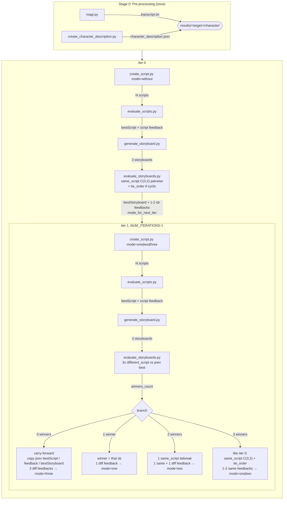

## Setup

### 1. Conda environment

```bash
conda create -n project python=3.12 -y
conda activate project
pip install -r requirements.txt
```

### 2. Google Cloud auth (Vertex AI)

The pipeline uses Vertex AI (`vertexai=True`). Authenticate once:

```bash
gcloud auth application-default login
```

### 3. `.env`

Copy the example file and fill in your values:

```bash
cp .env.example .env
```

```env
# Google Cloud (required for all Gemini calls via Vertex AI)
GOOGLE_CLOUD_PROJECT=<your-gcp-project-id>
GOOGLE_CLOUD_LOCATION=global

# Models
TEXT_MODEL=gemini-3.1-pro-preview
IMAGE_MODEL=gemini-3-pro-image-preview
VIDEO_REVIEW_MODEL=gemini-3.1-pro-preview
VIDEO_GENERATION_MODEL=dreamina-seedance-2-0-260128  # or wan2.7-i2v

# Pipeline defaults
NUM_SCRIPTS=3
NUM_CLIPS=6
NUM_STORYBOARDS=3
NUM_ITERATIONS=2
EXP1=0
EXP2=3

# Video generation API keys
ARK_API_KEY=<your-ark-key>       # required for Seedance
IMGBB_API_KEY=<your-imgbb-key>   # required for both models (first-frame hosting)
# DASHSCOPE_API_KEY=              # required only if using WAN (wan2.7-i2v)
```

See [Hyperparameters](#hyperparameters-env) for what each variable means.

### 4. Prepare a target

For each target, create a directory under `target/<name>/` containing:

```
target/<name>/
    manga_page.{png|jpg}              # full manga page
    ref.{png|jpg}                     # character reference sheet
    manga_panels/
        panel1.png
        ...
        panel6.png                    # NUM_CLIPS individual manga panel crops
    storyboard_panels/                # required for video generation only
        panel1.png
        ...
        panel6.png                    # hand-cut panels from bestStoryboard
```

---

## Usage

```bash
conda activate project
python src/run_all.py -t <target>
# or override iteration count:
NUM_ITERATIONS=3 python src/run_all.py -t <target>
python src/run_all.py -t <target> -n 3
```

All input files come from `target/<target>/` and all results land in `results/<target>/`.

---

## Output Layout

```
results/<target>/
    character/
        transcript.txt
        character_description.json

    iter<N>/
        scripts/
            script_{1..NUM_SCRIPTS}.json
        bestScript.json                 # carry-forward: copied from iter<N-1>
        storyboard/
            storyboard_{0..2}.{ext}
        bestStoryboard.{ext}            # carry-forward: copied from iter<N-1>
        intermediate/
            character.json              # script-level character review
            clip_{1..NUM_CLIPS}.json    # per-clip review
            feedback.json               # script-level feedback for next iter
                                        #   (carry-forward: copied from iter<N-1>)
            sb_compare_same_<A>_<B>.json
            sb_compare_diff_new<A>_vs_prev.json   # iter 1+ only
            bestStoryboard_meta.json    # {"branch", "winner_idx", "mode_for_next_iter"}
            storyboard_feedback.json    # {"feedbacks": [...]}  length 1-3
```

`branch` ∈ `{iter0_clean, iter0_cyclic, iterN_carry, iterN_1winner, iterN_2winner,
              iterN_3winner_clean, iterN_3winner_cyclic}` — purely for debugging.

`mode_for_next_iter` ∈ `{one, two, three}` — read by `run_all.py` to choose the
prompt for the next `create_script.py` invocation.

---

## Prompt → Step Mapping

| Step | Prompt |
|---|---|
| Character description | `prompts/create_character_description.txt` |
| Iter 0 script | `prompts/create_script_without_feedback.txt` |
| Iter 1+ script (1 sb feedback) | `prompts/create_script_with_one_feedback.txt` |
| Iter 1+ script (2 sb feedbacks) | `prompts/create_script_with_two_feedback.txt` |
| Iter 1+ script (3 sb feedbacks) | `prompts/create_script_with_three_feedback.txt` |
| Script eval — characters | `prompts/character_reviewer.txt` |
| Script eval — clips | `prompts/clip_reviewer.txt` |
| Storyboard generation | `prompts/create_storyboard.txt` |
| Storyboard compare (same script) | `prompts/storyboard_reviewer_same_script.txt` |
| Storyboard compare (different script) | `prompts/storyboard_reviewer_different_script.txt` |
| Cyclic-tie priority order | `prompts/storyboard_tie_order.txt` |
| Video generation | `prompts/video_generation.txt` |
| Video eval — first panel | `prompts/video_eval_first.txt` |
| Video eval — panel 2+ (with reference) | `prompts/video_eval_sequential.txt` |

---

## Hyperparameters (.env)

| Variable | Description |
|----------|-------------|
| `TEXT_MODEL` | Gemini model for text generation/evaluation |
| `IMAGE_MODEL` | Gemini model for storyboard image generation |
| `VIDEO_GENERATION_MODEL` | Video generation model (`dreamina-seedance-2-0-260128` or `wan2.7-i2v`) |
| `VIDEO_REVIEW_MODEL` | Gemini model used for video candidate evaluation |
| `NUM_SCRIPTS` | Number of scripts generated per iteration |
| `NUM_CLIPS` | Number of manga panels per page |
| `NUM_STORYBOARDS` | Number of storyboards generated per best script |
| `NUM_ITERATIONS` | Number of total iterations (Stage 0 + iter 0..N-1); default 3 |
| `EXP1`, `EXP2` | Few-shot example indices |
| `GOOGLE_CLOUD_PROJECT` | Vertex AI project ID |
| `GOOGLE_CLOUD_LOCATION` | Vertex AI region |
| `ARK_API_KEY` | Ark API key for Seedance video generation |
| `IMGBB_API_KEY` | ImgBB API key for hosting first-frame images (both models) |
| `DASHSCOPE_API_KEY` | DashScope API key — only needed when using `wan2.7-i2v` |

---

## Video Generation

After the storyboard pipeline produces a `bestScript.json` and you have hand-cut the storyboard panels into `target/<target>/storyboard_panels/`, run:

```bash
python src/create_video.py -t <target>
# override model (default: auto-detected from VIDEO_GENERATION_MODEL in .env):
python src/create_video.py -t <target> -m seedance
python src/create_video.py -t <target> -m wan
# resume an interrupted run:
python src/create_video.py -t <target> --auto-resume
```

### How it works

For each panel the pipeline:
1. Reads the matching clip from `bestScript.json` and filters to referenced characters only
2. Calculates video duration dynamically from manga panel area ratio + dialogue word count
3. Uploads the storyboard panel to ImgBB as first-frame reference
4. Submits **two** generation tasks (A & B) in parallel to the chosen API
5. Uploads both candidates to Gemini Files API and runs an LLM evaluation:
   - Panel 1: scored on Visual Realism, Physical Commonsense, Prompt Alignment
   - Panel 2+: same three criteria plus Coherency with the previous best video (weight 0.4)
6. Copies the winning candidate to `best_panel_<i>.mp4`

After all panels: concatenates every `best_panel_*.mp4` into `final_story.mp4` via ffmpeg.

### Duration clamping

| Model | Min | Max |
|-------|-----|-----|
| `wan` | 2s | 5s |
| `seedance` | 4s | 5s |

### Video output layout

```
results/<target>/
    video/
        <model>/                          # "wan" or "seedance"
            run_<YYYYMMDD_HHMMSS>/
                concat_list.txt
                final_story.mp4           # all panels merged
                panel_1/
                    tasks_info.json       # submitted task IDs (for resume)
                    candidate_1.mp4
                    candidate_2.mp4
                    gemini_eval_response.txt
                    best_panel_1.mp4
                panel_2/
                    ...
                panel_6/
                    ...
```

---
# Pipeline

