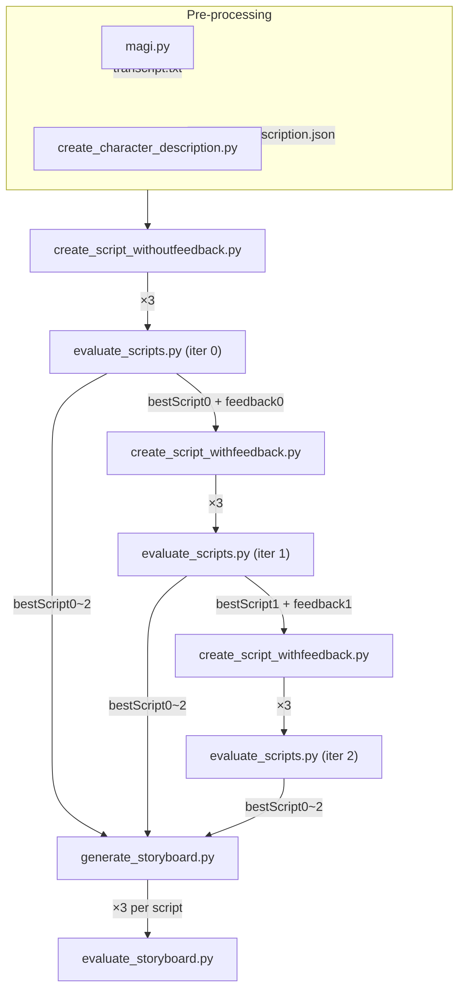

# Pipeline

---

## Input Files

| Script | Input Files |
|--------|-------------|
| `magi.py` | `target/manga_page.*` |
| `create_character_description.py` | `target/ref.*` |
| `create_script_withoutfeedback.py` | `few-shot_example/manga_page{EXP1,EXP2}` · `target/manga_panels/1~6.png` · `results/character/character_description.json` · `results/character/transcript.txt` · `few-shot_example/character_description{EXP1,EXP2}.json` · `few-shot_example/transcript{EXP1,EXP2}.txt` · `few-shot_example/script{EXP1,EXP2}.json` |
| `evaluate_scripts.py` | `target/manga_panels/1~6.png` · `target/manga_page.*` · `target/ref.*` · `results/scripts/script{iter}_{1~3}.json` |
| `create_script_withfeedback.py` | `target/manga_panels/1~6.png` · `results/scripts_review/bestScript{iter}.json` · `results/scripts_review/feedback{iter}.json` |
| `generate_storyboard.py` | `target/manga_page.*` · `target/ref.*` · `few-shot_example/manga_page{EXP1,EXP2}` · `few-shot_example/ref{EXP1,EXP2}` · `few-shot_example/example{EXP1,EXP2}` · `few-shot_example/script{EXP1,EXP2}.json` · `results/scripts_review/bestScript{0~2}.json` |
| `evaluate_storyboard.py` | `target/manga_page.*` · `target/ref.*` · `results/storyboard/storyboard_s*` |

## Output Files

| Script | Output Files |
|--------|-------------|
| `magi.py` | `results/character/transcript.txt` |
| `create_character_description.py` | `results/character/character_description.json` |
| `create_script_withoutfeedback.py` | `results/scripts/script{iter}_{1~3}.json` |
| `evaluate_scripts.py` | `results/scripts_review/character{iter}.json` · `results/scripts_review/clip_{1~6}_{iter}.json` · `results/scripts_review/bestScript{iter}.json` · `results/scripts_review/feedback{iter}.json` |
| `create_script_withfeedback.py` | `results/scripts/script{iter}_{1~3}.json` |
| `generate_storyboard.py` | `results/storyboard/storyboard_s{iter}_{0~2}.*` |
| `evaluate_storyboard.py` | `results/storyboard/storyboard_evaluation.txt` |
